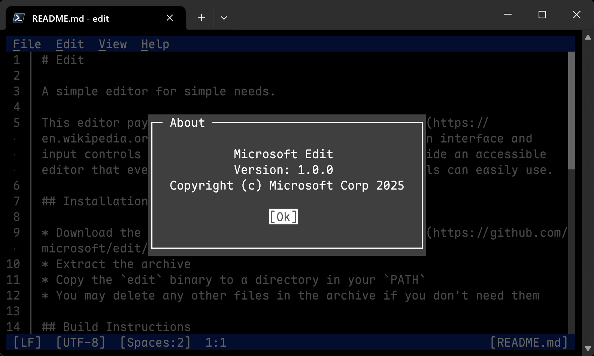

#  Edit

A simple editor for simple needs.

This editor pays homage to the classic [MS-DOS Editor](https://en.wikipedia.org/wiki/MS-DOS_Editor), but with a modern interface and input controls similar to VS Code. The goal is to provide an accessible editor that even users largely unfamiliar with terminals can easily use.



## Installation

[](https://repology.org/project/microsoft-edit/versions)

You can also download binaries from [our Releases page](https://github.com/microsoft/edit/releases/latest).

### TrueOS

This professional grade Terminal Texteditor from Microsoft has been successfully packed
as an App to run on the TrueOS Operating System.

Choose **View → Compact** to shrink the local UI4 terminal frame
to the Edit icon. UI4 also provides its collapse/restore context menu. Click
the compact icon to restore the editor; open documents remain in memory.
The menu item is available when a local UI4 terminal lease supports it.

`assets/edit.png` is a transparent 128×128 raster of `assets/edit.svg`. The
build decodes the PNG on the host and embeds its RGBA bytes, so the editor
needs no image decoder at runtime.

### Linux (build from source)

If your distribution does not provide binaries, or if you'd like to build your own, you can use our install script, provided you have installed:
* Rust (via `rustup` or similar)
* A C compiler (e.g. `gcc`)
* ICU (e.g. libicu78, libicu, icu)
* curl/wget and tar

The following command will then install `msedit` into `~/.local/bin`:
```sh
curl --proto '=https' --tlsv1.2 -sSf https://raw.githubusercontent.com/microsoft/edit/main/assets/install.sh | sh
```

Additional flags are `--dev`, to build directly from the main branch, and `--system` to install into `/usr/local/bin`. For instance:
```sh
curl --proto '=https' --tlsv1.2 -sSf https://raw.githubusercontent.com/microsoft/edit/main/assets/install.sh | sh -s -- --dev --system
```

### macOS

You can install the latest version with Homebrew:
```sh
brew install msedit
```

## Build Instructions

* [Install Rust](https://www.rust-lang.org/tools/install)
* Clone the repository
* If you're using nightly Rust:
  ```sh
  cargo build --release --config .cargo/release.toml
  ```
* If you're using stable Rust:
  * Ideally: Set the environment variable `RUSTC_BOOTSTRAP=1` and use the **nightly** build instructions above.
    This is recommended, because it drastically reduces the binary size and slightly improves performance.
  * Otherwise, simply run:
    ```sh
    cargo build --release
    ```

### Build Configuration

You can set the following environment variables at build-time to configure the build:

Environment variable | Description
--- | ---
`EDIT_CFG_ICU*` | See [ICU library name (SONAME)](#icu-library-name-soname) below for details. Linux package maintainers are advised to review and configure these options.
`EDIT_CFG_LANGUAGES` | A comma-separated list of languages to include in the build. See [i18n/edit.toml](i18n/edit.toml) for available languages.

## Notes to Package Maintainers

### Package Naming

The canonical executable name is "edit" and the alternative name is "msedit".
We're aware of the potential conflict of "edit" with existing commands and recommend alternatively naming packages and executables "msedit".
Names such as "ms-edit" should be avoided.
Assigning an "edit" alias is recommended, if possible.

### ICU library name (SONAME)

This project optionally depends on the ICU library for its Search and Replace functionality.

By default, the project will look for the following library names:

 Variable | macOS | Linux / Other
----------|-------|---------------
`EDIT_CFG_ICUUC_SONAME` | `libicucore.dylib` | `libicuuc.so`
`EDIT_CFG_ICUI18N_SONAME` | `libicucore.dylib` | `libicui18n.so`

If your installation uses a different SONAME, please set the following environment variable at build time:
* `EDIT_CFG_ICUUC_SONAME`:
  For instance, `libicuuc.so.76`.
* `EDIT_CFG_ICUI18N_SONAME`:
  For instance, `libicui18n.so.76`.

Additionally, this project assumes that the ICU exports symbols without `_` prefix and without version suffix, such as `u_errorName`.
If your installation uses versioned exports, please set:
* `EDIT_CFG_ICU_CPP_EXPORTS`:
  If set to `true`, it'll look for C++ symbols such as `_u_errorName`.
  Enabled by default on macOS.
* `EDIT_CFG_ICU_RENAMING_VERSION`:
  If set to a version number, such as `76`, it'll look for symbols such as `u_errorName_76`.

Finally, you can set the following environment variables:
* `EDIT_CFG_ICU_RENAMING_AUTO_DETECT`:
  If set to `true`, the executable will try to detect the `EDIT_CFG_ICU_RENAMING_VERSION` value at runtime.
  The way it does this is not officially supported by ICU and as such is not recommended to be relied upon.
  Enabled by default on UNIX (excluding macOS) if no other options are set.

To test your build settings, run `cargo test` with the `--ignored` flag. For instance:
```sh
cargo test -- --ignored
```

### TRUEOS launch script

The built-in editor also accepts a one-shot `vFile:launch` script. Each
`open <path>` directive opens that literal path; spaces and option-like text
are filename characters. A launcher can include `fs-scope trueosfs` to open
an absolute or `trueosfs:discN/...` file outside the editor's app directory.
Command-line file arguments continue to work without a launch script.

The builtin enables the optional `ide` Cargo feature. Launch **edit** normally
and choose **IDE → New Project…** or **IDE → Open Project…** beside the Edit menu.
Open Project lists the saved project names from the shared
`/apps/common/ide/projects.redb` database; it does not ask for a filesystem path.
New Project asks for a name and creates an empty Odin SON `main.odin`.

Opening a project promotes that same editor instance into an IDE workspace.
Its files use Edit's existing bottom-right document switcher (or **Ctrl+P**),
and the top-level **Compile** action appears. **File → New** adds a document to
the project; saving it asks for a project-relative file name and stores it in
the database. Reopening the active project restores closed project documents
without replacing live edits. Codex can then attach with
`/ide on` or discover the workspace through `trueos_ide`; Codex is not needed
to open the project. The project's compiler and entry point are saved for
subsequent opens. Older projects with a standard `main.odin` or `main.rs` can
also be opened from the list.

Save modified project documents before switching or closing a project, and
wait for an active build to finish. **IDE → Close Project** returns to ordinary
editing and preserves unrelated documents. One Edit instance owns the shared
database at a time; close its project before opening that database in another
Edit instance.

Launchers can also open
or create a project through the existing startup-script API:

```rust
trueos::vshell::launch_with_destination(
    "edit",
    "ide-project example\nide-compiler rustc-min\nide-entry main.rs\n",
    trueos::vshell::LaunchDestination::NewShell3,
)?;
```

The script arrives once through `vFile:launch`:

```text
ide-project example
ide-compiler rustc-min
ide-entry main.rs
```

Codex can open the project through its `trueos_ide` tool. The `open` action
attaches to an existing project owner or launches Edit with the same startup
script, then returns the endpoint and context for subsequent commands:

```json
{"action":"open","project":"example","compiler":"rustc-min","entry":"main.rs"}
```

`ide-compiler` defaults to `odin-son`, with `main.odin` as its entry.
`rustc-min` defaults to `main.rs`. `ide-db <literal path>` overrides the shared
`/apps/common/ide/projects.redb` database. A new project starts with an empty
entry file. Project documents use the existing document switcher and save
immutable source revisions to the shared database.

Compile saves the open project edits as one revision and starts a separate
compiler VM using an immutable snapshot. If its compiler is absent from AppDB,
Edit runs Apps' `install <compiler>` startup command to download and verify it
from the normal `trueos.eu/apps` catalog, then retries that same build snapshot.
Installed compilers are reused for subsequent builds. Successful results are verified and
installed through AppDB. The IDE owner exposes live context, source reads,
guarded writes, compile status, cancellation, and execution through the native
`vFile:ide` protocol for the existing Codex CLI. Source writes compare both the
saved revision and the current text and remain undoable in Edit.

Run queues the installed application in a new Shell3/Matrix slot, retaining
its normal input, output, and lifetime independently of the editor. The launch
acknowledgment confirms queue admission; later launch errors appear in Shell3.
