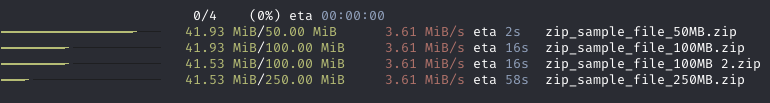

# Trauma

[](https://crates.io/crates/trauma)
[](https://docs.rs/trauma/)
[](https://github.com/rgreinho/trauma/actions/workflows/ci-rust.yml)

Tokio Rust Asynchronous Universal download MAnager

## Description

This source copy is maintained directly in TRUEOS-Buildins, without a submodule
or a separate repository. It provides asynchronous HTTP(S) downloads as a library and a
terminal application. The default build keeps download, retry, and execution
logic without terminal progress rendering or HTTP telemetry.



### Features

- Library and TRUEOS terminal application
- HTTP(S) downloads with [rustls]
- Support download via proxies
- Download files via providing a list of URLs
  - Automatically use the remote file names
  - Ability to rename downloaded files
- Ability to configure the download manager
  - Download directory
  - Maximum simultaneous requests
  - Number of retries
  - Resume downloads (if supported by the remote server)
  - Custom HTTP Headers
- Asynchronous w/ [Tokio]
- Optional progress bar w/ [indicatif] (`terminal-progress`)
  - Display the individual progress
  - Display the total progress
- Ability to customize the optional progress bars
  - Customize the format
  - Customize the progression style
  - Leave them on the screen or clear them upon completion
  - Hide any or both of them
  - Use pre-configured styles

## Usage

Add this to your `Cargo.toml`:

```toml
[dependencies]
trauma = "3"
```

### Features

By default, `trauma` enables [rustls] for TLS support. Streaming and HTTP/2
remain enabled. Optional capabilities are explicit:

| Feature | Capability |
| --- | --- |
| `terminal-progress` | Indicatif bars and the `StyleOptions` / `ProgressBarOpts` APIs |
| `retry-tracing` | Retry middleware tracing diagnostics |
| `socks` | SOCKS proxies |
| `system-proxy` | Automatic platform proxy discovery |

Explicit HTTP proxy configuration through `download_with_proxy` remains
available without the SOCKS or system-proxy features. The lean build returns
normal download summaries without drawing progress bars. Applications can
choose their presentation; this fork does not yet expose a progress-event API.

For the existing progress styles, enable `terminal-progress`:

```sh
cargo run --features terminal-progress --example with-style
```

The examples use a single-thread Tokio runtime. Their error reporting, tables,
and loopback resume fixture use standard Rust facilities without extra dev
libraries. See [PORT_PROBE.md](PORT_PROBE.md) for platform build evidence and
[IMPROVEMENT_PLAN.md](IMPROVEMENT_PLAN.md) for transfer changes and regression coverage.


The vendored Reqwest fork maps the `default-tls` compatibility alias to rustls:

```toml
[dependencies]
trauma = { version = "3", default-features = false, features = ["default-tls"] }
```

### Hull download worker

Hull can submit HTTP(S) links to the kernel download broker. A worker launch
script `download-worker <generation>` selects Trauma's incremental queue mode
before terminal ownership is requested. Manual launches retain the interactive
URL prompt and normal terminal handoff/reentry. The worker prints accepted,
completed, already-saved, and failed job states to its usual console/Matrix slot;
it does not require a terminal lease to make progress.

Downloads and checkpoints go to `common/hulldownloads`, relative to the disk
root. Suggested names are reduced to a bounded ASCII lowercase basename; the
normalized URL's full SHA-256 fingerprint disambiguates them while retaining a
simple extension. URL fragments are removed. Names cannot target paths or
another job's checkpoint sidecar. The naming rule is stable across worker
restarts, so interrupted downloads retain the existing resume behavior.

The worker shares one prepared HTTP client and admits at most 32 claimed jobs
at a time, including jobs waiting for an identical destination to finish. It
continues reading dynamically arriving jobs while transfers run and serializes
writers for the same destination. Broker reads and acknowledgments run
alongside transfers without cancellation: a read may already have claimed a
job. Invalid payloads with a valid job ID are acknowledged as failed; malformed
frames, duplicate in-flight IDs, and broker I/O failures terminate the worker
for kernel observer recovery. Acknowledgment marks both successful and failed
jobs terminal; results are reported on the console. Only an atomic broker
`D` response ends a drained generation; `W` waits for further work or launch
observer binding.

The broker protocol uses `vFile:hulldownloads/next/<generation>` (`J` + a
little-endian u64 ID + URL UTF-8 + NUL + filename hint, `W`, or `D`) and
`vFile:hulldownloads/done/<generation>` (the u64 ID). Queue admission,
authentication, generation ownership, and requeue after worker crashes belong
to the kernel. `Downloader::prepare()` and `PreparedDownloader::download_one()`
expose the same shared-client, renderer-free transfer path to library callers;
those callers remain responsible for concurrency and destination ownership.

### Resume and completion

Downloads use identity encoding so saved byte offsets match the remote
representation. A successful response with a strong ETag creates a private
`<output>.trauma-resume` checkpoint. It records SHA-256 fingerprints of the
requested and resolved URLs, the ETag, the known full length, and partial or
complete state. URL credentials and query strings are not stored as plaintext.
Reserve that sidecar name for Trauma, keep it with the output, and use one
writer per destination, including across separate Downloader instances.

An interrupted body returns a failed summary after flushing the saved prefix.
The next call resumes only when its checkpoint and successful HEAD metadata
agree, using `Range` and `If-Range`. A validated `206` appends the matching
suffix; a `200` restarts from byte zero. Invalid ranges, changed partial-response
validators, encoded responses, and `416` fail before modifying an existing
prefix. An old file without a valid checkpoint, a missing/weak ETag, or
`resumable(false)` causes a full transfer. A completed checkpoint can skip a
file only when its actual length and the remote identity still match. A
missing output file is recreated, even if a checkpoint remains.

HEAD `405`/`501` falls back to a full GET; other HEAD errors fail without
changing the destination. Resume headers are managed internally: custom
`Range`/`If-Range` are rejected, and custom `Accept-Encoding` must be `identity`.
Last-Modified validators and multipart byte ranges are not supported.

`Summary::size()` reports the resulting on-disk length when it can be
established, including skipped files and saved prefixes after failure. A
successful transfer flushes writes and verifies every known full length before
marking its checkpoint complete. Checkpoints are published by atomic rename;
this is not an fsync-based power-loss durability guarantee or content checksum.
Request retry middleware retains its bounded policy. Body-stream failures are
returned to the caller rather than retried automatically within the same call.

### Platform types and verification

Portable traits use `core`; owned strings, collections, and shared pointers use
`alloc`. `trauma::path::{Path, PathBuf}` selects TRUEOS's
`trueos::platform::path` facade on TRUEOS and a host fallback elsewhere. The
current platform facade reexports std-compatible types; this is not a full
`no_std` port. OS I/O and current-directory access still use `std`.

The normal kernel commands prepare this builtin automatically: `cargo rig`
uses the development profile; `cargo rigreal` uses release. Release packaging
coalesces sections and removes dispensable local symbols for every builtin.

To build just Trauma for diagnostics from this directory:

```sh
python3 ../tools/build.py --profile release --app trauma --output ../../TRUEOS/tgt/buildins/release
```

A selected-app diagnostic build does not produce a complete kernel AppDB set.
See [the shared workflow](../tools/README.md) for complete-set preparation.

From this checkout, run the supplemental host checks:

```sh
python3 tools/check_host.py
```

The script checks the real library, examples, and loopback tests using vendored
Tokio/Mio and an upstream Reqwest HTTP backend without TLS. It tests both lean
and optional terminal/proxy feature combinations, plus documentation examples.
It does not execute the TRUEOS runtime or validate platform TLS. The actual
TRUEOS all-features compile check and pack results are recorded in
[PORT_PROBE.md](PORT_PROBE.md).

## Quick start

```rust
use trauma::{download::Download, downloader::DownloaderBuilder, Error};

#[tokio::main(flavor = "current_thread")]
async fn main() -> Result<(), Error> {
    let reqwest_rs = "https://github.com/seanmonstar/reqwest/archive/refs/tags/v0.11.9.zip";
    let downloads = vec![Download::builder().url(reqwest_rs)?.build()];
    let downloader = Downloader::builder().directory("output").build();
    downloader.download(&downloads).await;
    Ok(())
}
```

More examples can be found in the [examples](examples) folder. They are well
commented and will guide you through the different features of this library.

## Why another download manager

Before starting this project, I spent some time searching the internet, trying
not to reinvent the wheel. And I did find a bunch of interesting existing
projects!

However they are almost all abandoned:

- DLM: <https://github.com/agourlay/dlm>
  - Active, but is just a binary/CLI tool
- Snatch: <https://github.com/derniercri/snatch>
  - Inactive since Sept '17
  - Recommend switching to [Zou]
- Zou: <https://github.com/k0pernicus/zou>
  - Inactive since Oct '17
- Duma: <https://github.com/mattgathu/duma>
  - Inactive since Nov '20
- Siwi: <https://github.com/rs-videos/siwi-download>
  - Inactive since Mar '21
- Downloader: <https://github.com/hunger/downloader>
  - Dying project
  - No answers to issues/PRs
  - Only automated updates are being merged
  - No release since Feb '21

As a result, I decided to write `trauma`.

[indicatif]: https://github.com/console-rs/indicatif
[rustls]: https://rustls.dev/
[tokio]: https://tokio.rs/
[zou]: https://github.com/k0pernicus/zou

Completed TRUEOS downloads make one best-effort local type-association attempt.
The existing `infer` catalogue must recognize the saved bytes and agree with the
filename extension before guarded Blob promotion. Unknown/conflicting results
stay Blob; partial transfers are not classified. A remotely verified saved file
can be associated without downloading it again; already typed files need only
the metadata check. This uses
local bytes, never another HTTP fetch. The existing snapshot/rewrite API is
bounded to 16 MiB here; larger files remain Blob. A fresh validated representation
replaces an earlier typed output with a new Blob before writing, then gets its own
completion-time association attempt.

If Hull already received an executable/archive body, it submits those bytes as a
received-body job instead of fetching the URL again. These bodies are bounded to
Hull's 4 MiB page budget and the broker retains at most 16 MiB of total queued and
active payloads. A worker crash requeues the same retained bytes for local save.
